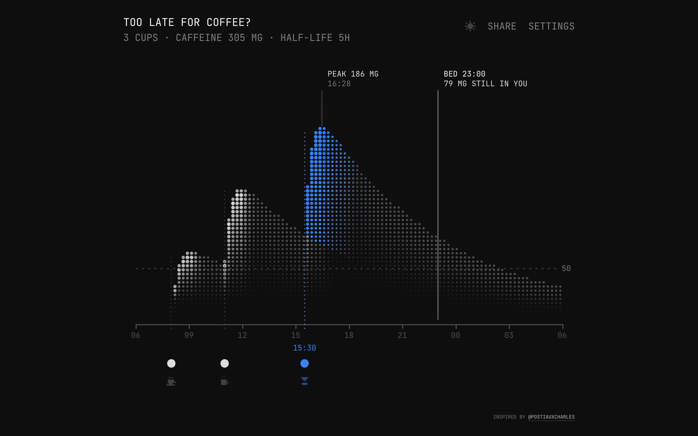

# Too late for coffee?

**See how much caffeine is still in you at bedtime.**

You had a coffee at 8, another at 11 and a pour-over at 15:30. Will it keep you awake tonight? Tap in your cups and the chart shows the answer.

**[Open the app → too-late-for-coffee.vercel.app](https://too-late-for-coffee.vercel.app)**



## Why you will like it

- **One look, one answer.** The chart shows your peak and the milligrams still in you at bedtime.
- **Your day in seconds.** Tap the chart to add a cup, then drag it to the time you drank it.
- **Real drinks.** Pick tea, matcha, espresso, brewed coffee, pour-over or a caffeine pill, or type your own amount.
- **Your body, your numbers.** Set your bedtime, your sleep limit and your caffeine half-life.
- **Share your day.** One link holds all your cups and settings. On a phone, SHARE opens the share sheet.
- **Works offline.** Install it as an app on your phone or desktop.
- **Easy on the eyes.** A calm dot-matrix design in light and dark theme.

## How to use it

| Action | How |
|---|---|
| Add a cup | Click the chart, or press the track under the hours |
| Move a cup | Drag its dot on the track |
| Change the drink | Click the drink icon under the dot |
| Remove a cup | Double-press its dot, or select it and press Delete. A click on the rise of the blue area also works |
| Set the limit | Drag the limit label up or down |
| Set bedtime | Drag the bed line left or right |
| Reset the limit or bedtime | Double-press the line |

All settings are also in **SETTINGS**.

> This app gives an estimate for curiosity. It is not medical advice.

---

## How it works

Each cup follows a one-compartment model with first-order absorption and elimination (the Bateman function):

```
C(t) = D · ka / (ka − ke) · (e^(−ke·t) − e^(−ka·t))
```

- `D` is the caffeine dose in mg.
- `ka` is the absorption rate, `2.8 /h`. A single cup peaks after about 68 minutes.
- `ke` is `ln 2 / half-life`. The default half-life is `5 h`, and you can set `1–12 h`.

The chart adds all cups together over one day, from 06:00 to 06:00.

## Tech stack

- [Preact](https://preactjs.com) 11 and TypeScript
- [Vite](https://vite.dev) 8
- [Tailwind CSS](https://tailwindcss.com) 4
- Canvas 2D for the chart, with no chart library
- [vite-plugin-pwa](https://vite-pwa-org.netlify.app) for offline use and install
- [JetBrains Mono](https://www.jetbrains.com/lp/mono/) for the type
- [Vercel](https://vercel.com) for hosting

## Getting started

You need Node.js and [pnpm](https://pnpm.io).

```sh
pnpm install
pnpm dev       # start the dev server at http://localhost:5173
pnpm build     # type check and build to dist/
pnpm preview   # serve the build
```

## Share link format

A share link holds the day in the query string. Clock times use `HHMM`.

```
?cups=0800-75,1100-95,1530-135&bed=2300&hl=5&limit=50&dose=95
```

| Key | Meaning | Range |
|---|---|---|
| `cups` | Cups as `time-mg`, separated by commas | Up to 20 cups, `0–500` mg each |
| `bed` | Bedtime | `1600–0500` |
| `hl` | Half-life in hours | `1–12` |
| `limit` | Sleep limit in mg | `5` or more |
| `dose` | Default dose for a new cup in mg | `20–400` |

The app leaves out a setting that has its default value. The first edit removes the query from the address bar.

## Project structure

```
src/
  App.tsx            page layout, header and theme toggle
  CaffeineChart.tsx  chart, cup handles and drag
  draw.ts            canvas drawing of the dot matrix
  caffeine.ts        caffeine model, drinks and defaults
  share.ts           share link read and write
  DrinkMenu.tsx      drink picker
  SettingsPanel.tsx  settings popover
  SharePanel.tsx     share popover and share sheet
```

## Credits

Inspired by [@PostiauxCharles](https://x.com/PostiauxCharles/status/2119801461278146758).
